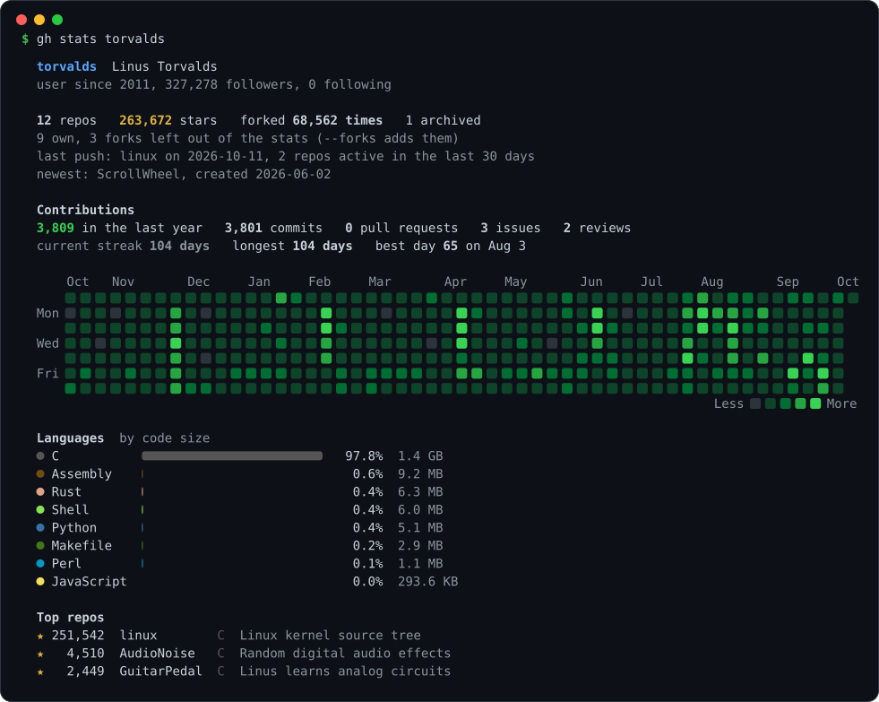
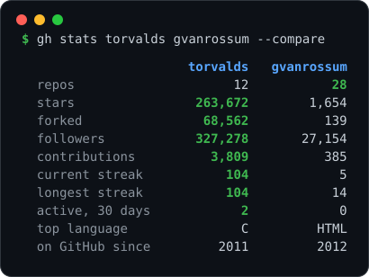

# gh-stats

GitHub stats for any user or org, right in your terminal. Contribution heatmap, streaks, languages by code size, top repos, in one command.

<p align="center">
  
</p>

The colors are the ones GitHub uses, so it looks like the profile page. The image above was made by gh-stats itself with `--svg`.

## Install

As a GitHub CLI extension:

```
gh extension install CanReader/gh-stats
gh stats              # your own stats
gh stats torvalds     # anyone else
```

Or with cargo, which gives you a `gh-stats` binary:

```
cargo install --git https://github.com/CanReader/gh-stats
```

Prebuilt binaries for Linux, macOS and Windows are on the [releases page](https://github.com/CanReader/gh-stats/releases).

## Usage

```
gh-stats                           you (if you're logged in with gh)
gh-stats torvalds                  one user
gh-stats rust-lang                 orgs work too
gh-stats you yourfriend            several at once
gh-stats you yourfriend --compare  side by side
gh-stats you --svg card.svg        save it as an image
gh-stats you --since 2025          only repos made since then
gh-stats you -t 10                 show 10 top repos (default 5, 0 hides them)
gh-stats you --forks               count forked repos too
gh-stats you --public              leave out private repos
gh-stats you --md                  Markdown for your profile README
gh-stats you --json                JSON for scripts
```

The repo count matches the number on your GitHub profile. Forks are left out of stars and languages by default so those are about your own work, `--forks` adds them back.

## Contributions

When you're logged in (see Token below) you get the green squares from the profile page, plus commits, pull requests, issues and reviews for the last year, your current and longest streak and your best day. It fits as many weeks as your terminal is wide.

Orgs don't have a contribution graph on GitHub, so that part is skipped for them.

## Languages

Logged in, languages are measured by code size across all your repos, the same numbers GitHub uses for the language bar on a repo page. A C++ repo with some CUDA in it counts for both. Without a token each repo counts once, by its main language.

## Compare

<p align="center">
  
</p>

```
gh-stats torvalds gvanrossum --compare
```

Works with more than two names too. The highest number in each row is highlighted.

## Cards for your profile

Two ways to show it on your `username/username` README:

```
gh-stats you --svg stats.svg       an image like the ones above
gh-stats you --md                  plain Markdown tables
```

Both only use public repos since they're meant to be shared. No image service has to be up for either of them to show.

## Private repos

When you look at yourself, or at an org you're a member of, private repos are counted too and marked `(private)` in the list. For anyone else you only see public ones. `--public` turns this off.

## Token

It works without a token, but GitHub only gives 60 requests an hour that way, and contributions and code sizes need one. gh-stats looks for a token in this order:

1. `GITHUB_TOKEN`
2. `GH_TOKEN`
3. the GitHub CLI, if you're logged in with `gh auth login`

So if you use `gh` you don't have to set anything. It only reads, nothing is ever written.

## Shell completions

```
gh-stats --completions zsh > ~/.zfunc/_gh-stats
gh-stats --completions bash > ~/.local/share/bash-completion/completions/gh-stats
gh-stats --completions fish > ~/.config/fish/completions/gh-stats.fish
```

## Notes

- Answers are cached for 10 minutes in your cache folder, so running it again is instant and costs no API calls. `--refresh` skips the cache. The files are only readable by you since they can include private repo names.
- Big accounts are fine, repos are fetched 100 at a time.
- Network hiccups and GitHub 5xx errors are retried a couple of times before giving up.
- If you hit the rate limit it tells you when it resets.
- If one name in a list fails, the rest still print and the exit code is 1.
- Colors turn off when the output isn't a terminal or when `NO_COLOR` is set. `--color always` or `--color never` forces it.

## License

MIT
